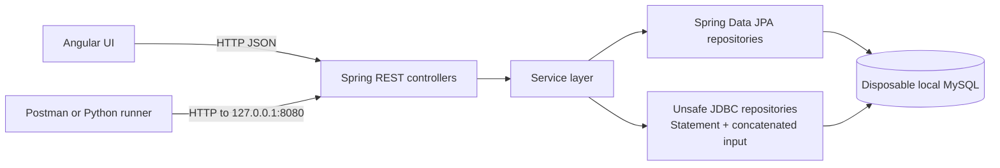

# Personal Finance Tracker: SQL Injection Practice Lab

A small personal finance REST API and Angular interface built as a local security learning lab. It manages fictional income and expense transactions, categories, accounts, and a demo user. Several JDBC queries intentionally concatenate request input so developers can observe how SQL injection happens and practice remediating it.

## ⚠️ Intentional vulnerabilities — local lab only

**This application is deliberately vulnerable. Run it only on your own machine with the fictional practice database. Do not expose it to the internet or a shared network. Never connect it to production systems, real financial data, or real credentials.** The API has no authenticated session or per-user data isolation. The login endpoint is a query demonstration, not access control.

The application binds its backend to `127.0.0.1`. Keep that setting in place. The checked-in configuration and startup initializer contain weak local demonstration defaults, including a demo user; replace or remove those defaults and use environment-provided secrets before any public or shared deployment. This project is not production-ready.

## Table of contents

- [Why study SQL injection?](#why-study-sql-injection)
- [Technology stack](#technology-stack)
- [Architecture](#architecture)
- [Learning objectives](#learning-objectives)
- [Practical SQL Injection Demonstrations and Evidence](#practical-sql-injection-demonstrations-and-evidence)
- [Vulnerability findings and source files](#vulnerability-findings-and-source-files)
- [Repository structure](#repository-structure)
- [Prerequisites and installation](#prerequisites-and-installation)
- [Database configuration](#database-configuration)
- [Clone and run](#clone-and-run)
- [Postman testing guide](#postman-testing-guide)
- [Automated Python security testing](#automated-python-security-testing)
- [Understanding the test report](#understanding-the-test-report)
- [Secure coding and remediation](#secure-coding-and-remediation)
- [Run tests after remediation](#run-tests-after-remediation)
- [Contribution guidelines](#contribution-guidelines)
- [Responsible use and security disclaimer](#responsible-use-and-security-disclaimer)

## Why study SQL injection?

SQL injection remains relevant because applications often combine user input with database commands. A search box, filter, identifier, or login field can become part of SQL syntax if code builds a query by concatenating strings. Attackers may then change which rows a query returns or cause database errors. A secure query keeps SQL structure separate from values by binding values as parameters.

This lab makes that difference visible in a disposable environment. It includes both Spring Data JPA paths and intentionally unsafe JDBC paths so learners can compare their implementation and observed behavior.

## Technology stack

| Area | Technology | Version/configuration in repository |
|---|---|---|
| Language | Java | 21 toolchain |
| Backend | Spring Boot | 4.1.2 |
| Persistence | Spring Data JPA, JDBC | Versions managed by Spring Boot plugin |
| Database | MySQL | Connector version managed by Spring Boot dependency management |
| Build | Gradle Wrapper | 9.8.2 |
| Frontend | Angular | 20.x |
| Frontend language | TypeScript | 5.8.x |
| Security runner | Python | Python 3; standard library only |

The backend dependencies include Spring MVC, validation, data JPA, and JDBC. The repository includes a Spring context-load test. No Python package installation is needed for the assessment runner.

## Architecture



Ordinary create, update, and delete operations use Spring Data JPA. Selected read and login operations are routed through the three `Unsafe*Repository` classes and execute SQL with JDBC `Statement`. The demo data initializer seeds fictional categories, accounts, transactions, and a fictional account record when the application starts.

## Learning objectives

- Recognize the difference between SQL code and user-supplied values.
- Trace HTTP parameters from controllers through services to repository queries.
- Compare normal input with controlled Boolean true/false and tautology inputs.
- Distinguish SQL behavior from URL decoding, request validation, and generic HTTP errors.
- Understand why query parameterization and allow-listed identifiers matter.
- Repeat the same checks after remediation and retain evidence for comparison.

## Practical SQL Injection Demonstrations and Evidence

The results below summarize the latest successful local run recorded in `transaction_security_report.md` (9 November 2026). The runner reached the application and used fictional seeded records. The report is a text/JSON response record; **the repository contains no screenshots**, and none are implied here. Response contents are summarized to avoid reproducing profile data.

### Confirmed Boolean-based SQL injection: transaction search

Boolean-based injection changes a condition so the database returns rows that should not match the user’s search. The endpoint is `GET /api/transactions/search`, with required query parameter `q`.

| Request | Input | Observed response |
|---|---|---|
| Baseline | `q=groceries` | HTTP 200; 2 matching transactions |
| Tautology probe | `q=%' OR 1=1 -- ` | HTTP 200; all 10 transactions |

**Assessment: VULNERABLE (confirmed by response difference and source review).** The input changes the predicate rather than remaining a search value. This is the primary confirmed finding.

The vulnerable code in `UnsafeTransactionRepository.search` effectively constructs:

```sql
SELECT ...
FROM financial_transactions t ...
WHERE t.description LIKE '%<q>%'
```

Since `<q>` is inserted into the SQL string before `Statement.executeQuery`, SQL punctuation in the request is interpreted as query syntax. Encoding a request for transport does not make the value safe after the server decodes it.

A parameterized version separates the SQL template from the search value:

```java
String sql = "SELECT ... WHERE t.description LIKE ?";
try (PreparedStatement ps = connection.prepareStatement(sql)) {
    ps.setString(1, "%" + q + "%");
    try (ResultSet rs = ps.executeQuery()) {
        // Map rows as before.
    }
}
```

With this form, SQL punctuation is data inside the bound value; it cannot close the string literal or add a predicate.

### Boolean injection in other repository paths

| Technique/path | Baseline and test | Actual observation | Assessment |
|---|---|---|---|
| Category search — `GET /api/categories/search?name=...` (also `/api/category/search`) | Baseline `name=Groceries`; test `name=%' OR 1=1 -- ` | Both HTTP 200; response count expanded from 1 to 5 | **VULNERABLE** |
| User lookup — `GET /api/users/lookup?username=...` | Baseline `username=labuser`; test `username=' OR '1'='1' -- ` | HTTP 200; both responses had the same single-record shape. Source concatenates `username` into SQL; exact row-count differential is unavailable because lookup returns one record | **VULNERABLE by source and observed altered predicate; row differential inconclusive** |
| Login query — `POST /api/auth/login` | JSON: `{"username":"no-such-lab-user","password":"' OR '1'='1' -- "}` | HTTP 200 and `success: true`, returning a user object | **VULNERABLE (authentication-query bypass demonstrated)** |

The login route does not issue a session and protects no other endpoint. Its successful response demonstrates the unsafe query behavior, not a working authentication system.

### UNION-based SQL injection

UNION injection attempts to append another compatible `SELECT` result to the original query. Source inspection shows the transaction search selects 11 columns, category search selects 5, and user lookup selects 4. The runner made one read-only `UNION SELECT` probe per path using only `NULL` expressions; it did not query another table.

| Path | Input shape | Actual response | Assessment |
|---|---|---|---|
| Transaction search | `q=%' UNION SELECT NULL,NULL,NULL,NULL,NULL,NULL,NULL,NULL,NULL,NULL,NULL -- ` | HTTP 500 with generic `Internal Server Error` JSON | **INCONCLUSIVE** |
| Category search | `name=%' UNION SELECT NULL,NULL,NULL,NULL,NULL -- ` | HTTP 500 with generic `Internal Server Error` JSON | **INCONCLUSIVE** |
| User lookup | `username=%' UNION SELECT NULL,NULL,NULL,NULL -- ` | HTTP 500 with generic `Internal Server Error` JSON | **INCONCLUSIVE** |

These responses do not establish whether the UNION was syntactically compatible or whether a SQL exception, result mapping failure, or another server error occurred. No database-specific error or injected data was observed.

### Error-based SQL injection

Error-based injection relies on database errors being exposed in a way that reveals SQL behavior or information. The runner sent the single quote (`'`) to transaction search (`q`), category search (`name`), and user lookup (`username`). Each returned HTTP 500 with generic JSON such as `{"status":500,"error":"Internal Server Error",...}`.

**Assessment: INCONCLUSIVE.** A generic 500 is an application response, not proof of a database error and not evidence that database details were disclosed. No database-specific message was present in the response. The app’s server logs are needed to identify the underlying exception.

### Blind SQL injection

Blind injection infers query behavior from differences in responses when the application does not return database errors. The transaction-search endpoint was tested with controlled true and false conditions.

| Condition | HTTP | Result count |
|---|---:|---:|
| `q=groceries%' AND '1'='1' -- ` | 200 | 2 |
| `q=groceries%' AND '1'='2' -- ` | 200 | 0 |

**Assessment: VULNERABLE (confirmed Boolean response differential).** Correct query encoding allowed both requests to reach the endpoint, and the result count changed as predicted by the condition. Earlier attempts containing malformed percent-encoding such as `%%27` did not test SQL behavior: Tomcat logged “Character decoding failed” / “The hexadecimal encoding is invalid” before the controller could process the value. Those were URL decoding failures, not SQL results.

### Time-based SQL injection

Time-based injection uses a database-side delay as an observable signal. The local runner sent one conditional delay probe to transaction search, with a five-second client timeout. The request took about 5 seconds and timed out without an HTTP response; the baseline returned HTTP 200 in about 4 milliseconds.

**Input:** `q=%' AND IF(1=1,SLEEP(1),0) AND 'x'='x' -- `. **Assessment: INCONCLUSIVE, with a suspicious timing signal.** The generated report currently labels this probe `VULNERABLE`, but a client timeout by itself cannot prove a database-side delay or identify its cause. No completed delayed response was captured. Treat this as a hypothesis requiring a repeat under a stable local run and corroboration from application/database timing logs. The probe is limited to one request; it is not a load test.

### Second-order SQL injection

Second-order injection occurs when an application stores input safely, then later uses the stored value unsafely in a different query. This technique was **NOT TESTED dynamically**; there is no test input because the runner deliberately avoids create/update requests and does not leave records in the local database. Source review found no inspected transaction-description or category-name flow that later concatenates the stored value into SQL. This is a limited source finding, not proof that no second-order path exists anywhere in the project.

### Dynamic SQL injection and sorting

Dynamic SQL injection often involves values or identifiers incorporated into query text. The filtered list path on `GET /api/transactions` is vulnerable: normal `type=EXPENSE` returned 7 rows, while `type=EXPENSE' OR '1'='1' -- ` returned all 10 (HTTP 200).

**Assessment: VULNERABLE for the `type` filter.** `UnsafeTransactionRepository.where` concatenates `type` into a quoted SQL predicate. Other filtered parameters such as `q` use the same unsafe construction.

Sorting is a separate behavior. `TransactionController` declares `type`, `q`, `startDate`, `endDate`, `page`, and `size`, but no `sort`, `sortBy`, or `direction` argument. A request with an invalid `sort` value returned the normal list; metadata showed `sorted: false`. **Sorting support was not found, and dynamic sort injection was not demonstrated.**

### SQL injection remediation verification

The latest report compared the current run with the prior confirmed Boolean search finding and marked it **STILL REPRODUCIBLE**. Therefore **remediation verification is VULNERABLE / remediation not yet demonstrated** for that finding. The other runtime findings above likewise show that unsafe paths remain present in this recorded run. Re-run after fixing the application; the Python runner retains prior confirmed technique flags in `transaction_security_history.json` and reports whether they reproduce.

### Distinguishing request, framework, server, and database errors

- **Spring request validation:** omitting required `q` from `GET /api/transactions/search` produced HTTP 400. Logs identified `MissingServletRequestParameterException`. This means Spring rejected a request with no required parameter; it says nothing about SQL.
- **Tomcat URL decoding:** malformed percent-encoding such as `%%27` caused “Character decoding failed” / “The hexadecimal encoding is invalid.” The request failed during URL decoding, before controller/database processing.
- **Generic HTTP 500:** malformed quotes and UNION probes received generic `Internal Server Error` JSON. Without database-specific log evidence, these remain inconclusive.
- **Database error:** no database-specific error message was captured in the reported responses. Do not classify a generic 400 or 500 as a confirmed SQL injection result.

## Vulnerability findings and affected source files

| Finding | Endpoint(s) | Source |
|---|---|---|
| Search predicate concatenation | `GET /api/transactions/search`; `GET /api/transactions?q=...` | `transaction/UnsafeTransactionRepository.java`, called by `TransactionService.java` |
| Filter value concatenation (`type`, `q`) and count query | Filtered `GET /api/transactions` | `transaction/UnsafeTransactionRepository.java` |
| Raw path ID concatenation | `GET /api/transactions/{id}` | `transaction/UnsafeTransactionRepository.java` |
| Category search concatenation | `GET /api/categories/search?name=...` and `/api/category/search` | `category/UnsafeCategoryRepository.java`, called by `CategoryService.java` |
| Username lookup and credential concatenation | `GET /api/users/lookup?username=...`; `POST /api/auth/login` | `user/UnsafeUserRepository.java`, called by `UserService.java` |
| Required-parameter handling and route declarations | Transaction routes and query parameters | `transaction/TransactionController.java` |
| Error response mapping | API exception handling | `transaction/ApiExceptionHandler.java` |

These repositories are intentionally unsafe lab examples. The evidence above confirms several injectable paths; UNION and error-based exploitation remain inconclusive, second-order testing was not done, and sorting is not implemented.

## Repository structure

```text
.
├── src/main/java/com/sekutlu/finance/
│   ├── account/                 # Account controller, service, JPA repository and model
│   ├── category/                # Category API; includes UnsafeCategoryRepository
│   ├── common/                  # Base types and fictional startup sample data
│   ├── transaction/             # Transaction API; includes UnsafeTransactionRepository
│   └── user/                    # User/login API; includes UnsafeUserRepository
├── src/main/resources/
│   └── application.properties   # Local Spring and database configuration
├── src/test/java/               # Spring context-load test
├── frontend/                    # Angular 20 UI
├── gradle/wrapper/              # Gradle 9.8.2 wrapper
├── transaction_security_test.py # Local-only Python assessment runner
├── transaction_security_report.md
├── transaction_security_history.json
└── README.md
```

## Prerequisites and installation

- Java 21 JDK
- MySQL Server available locally
- Node.js and npm compatible with Angular 20 (Node.js 20.19+ or 22.12+ is recommended by Angular 20)
- Python 3 for the optional assessment runner
- macOS, Linux, or Windows with the included Gradle wrapper (examples below use macOS/Linux shell syntax)

Clone the repository and enter its directory:

```sh
git clone <repository-url>
cd finance
```

The Gradle wrapper downloads Gradle 9.8.2 if it is not already installed. The wrapper and dependency downloads require network access on first use.

## Database configuration

Use a dedicated, disposable local schema and a dedicated database account. Create them using your local MySQL administration tool. Hibernate is configured with `ddl-auto=update`; the app creates/updates tables and seeds fictional records at startup. Do not point it at a database that contains anything you need to preserve.

For example, create a schema named `finance_sqli_lab` and a local-only database user with privileges limited to that schema. Choose the password locally; do not commit it or paste a real secret into this README. The application reads:

| Environment variable | Purpose | Example shape |
|---|---|---|
| `DB_URL` | JDBC connection URL | `jdbc:mysql://127.0.0.1:3306/finance_sqli_lab` |
| `DB_USER` | Local database account | Set to the account you created |
| `DB_PASSWORD` | Local database password | Supply via shell environment or a secret manager |

On macOS/zsh, export your local values before starting the backend:

```sh
export DB_URL='jdbc:mysql://127.0.0.1:3306/finance_sqli_lab'
export DB_USER='your_local_lab_user'
read -s 'DB_PASSWORD?Local lab database password: '
export DB_PASSWORD
printf '\n'
```

The source configuration contains local demonstration fallback values for these variables. Use only the disposable local database and override those values in your environment. Never replace them with production credentials.

## Clone and run

Start the backend from the repository root:

```sh
./gradlew bootRun
```

The API binds to `127.0.0.1:8080`. Start the Angular UI in a second terminal:

```sh
cd frontend
npm install
npm start
```

The Angular development server normally opens at `http://localhost:4200`. API base URL: `http://127.0.0.1:8080`.

The initializer seeds five categories, three accounts, ten transactions, and one fictional demo user when missing. Do not use that user or its credentials outside this lab. Sample transaction dates are relative to the date the application initializes.

## Postman testing guide

Set the request base URL to `http://127.0.0.1:8080`. For all exercises, use only the fictional seeded records. The `q` parameter on transaction search is required.

| Purpose | Method and request | Baseline input |
|---|---|---|
| Search transactions | `GET /api/transactions/search?q=groceries` | `q=groceries` |
| Filter list | `GET /api/transactions?type=EXPENSE&page=0&size=20` | `type=EXPENSE` |
| Search categories | `GET /api/categories/search?name=Groceries` | `name=Groceries` |
| Look up fictional user | `GET /api/users/lookup?username=labuser` | `username=labuser` |
| Credential query demonstration | `POST /api/auth/login`, JSON body | Use fictional test values only |

For tests with quotes, ampersands, percent signs, or spaces, let Postman encode query parameters using its Params interface. Avoid manually concatenating malformed `%` escapes into a URL. A malformed URL may be rejected by Tomcat before Spring or the database sees it.

Examples of ordinary API routes are listed below. The source is authoritative if routes change.

| Method | Endpoint | Purpose |
|---|---|---|
| `GET` | `/api/transactions` | List/filter/page transactions |
| `GET` | `/api/transactions/summary` | Totals and balance |
| `GET` | `/api/transactions/{id}` | Retrieve transaction (unsafe JDBC path) |
| `POST`, `PUT`, `DELETE` | `/api/transactions[/{id}]` | Transaction CRUD (writes; use carefully) |
| `GET`, `POST` | `/api/categories` | List/create categories |
| `GET`, `PUT`, `DELETE` | `/api/categories/{id}` | Category details and changes |
| `POST`, `GET`, `PUT`, `DELETE` | `/api/accounts[/{id}]` | Account operations; list requires `userId` |
| `POST` | `/api/users/register` | Register a fictional user |

## Automated Python security testing

The existing `transaction_security_test.py` runner is restricted to `127.0.0.1:8080`. It uses Python's standard library and includes read-only transaction/category/user query tests plus a login POST that invokes a SELECT only. It does not create, update, or delete records. It makes one bounded time probe and uses NULL-only UNION probes; it does not perform enumeration or stacked statements.

Start the application and run from the repository root:

```sh
python3 transaction_security_test.py
```

It writes `transaction_security_report.md` and retains previous confirmed technique flags in `transaction_security_history.json`. After a fix, rerun the same command to compare whether previous confirmed findings still reproduce. The test runner cannot verify second-order injection without creating data; that test remains `NOT TESTED` unless a separate disposable-data procedure is deliberately designed.

If the runner prints **Python execution environment restriction** with `Operation not permitted`, its execution sandbox blocked loopback access. That does not mean the application is down. Run the command directly in macOS Terminal on the same Mac where Spring Boot is running. A **connection refused** result means the local address was reachable but no process accepted the connection; a **connection timeout** means no timely response was obtained. HTTP 4xx/5xx responses indicate an application/server response, but do not alone confirm SQL injection.

## Understanding the test report

Each report row records technique, endpoint, method, input, HTTP status, response time, response size, expected and actual behavior, evidence, and assessment.

| Status | Meaning |
|---|---|
| `PASS` | The test ran and its evidence did not reproduce the tested vulnerability. |
| `FAIL` | A required check or expected safe behavior failed. A 4xx/5xx by itself is not this conclusion. |
| `VULNERABLE` | Evidence demonstrates changed query behavior or a controlled delay. Check timeout-only signals with logs before drawing a final conclusion. |
| `INCONCLUSIVE` | The request or evidence did not establish database behavior. |
| `NOT TESTED` | The technique was intentionally not exercised, for example because it requires writing stored data. |

The report can distinguish transport restrictions, connection refusal, connection timeout, HTTP application errors, and successful responses. It cannot read server logs; correlate generic errors with local Spring/Tomcat/MySQL logs when needed.

## Secure coding and remediation

1. Replace string-built SQL values in all three unsafe repositories with `PreparedStatement` placeholders or Spring Data JPA parameter binding.
2. Bind values such as search terms, IDs, usernames, passwords, types, and dates. Convert and validate numeric IDs rather than treating path text as SQL.
3. If sorting is added, map accepted public sort keys to a fixed allow-list of entity properties and validate direction as `asc` or `desc`; SQL identifiers generally cannot be safely supplied as ordinary value parameters.
4. Keep client error responses generic. Log diagnostic details server-side without returning SQL, schema, or credential information to clients.
5. Hash passwords with an appropriate password hashing algorithm; do not compare or store plaintext credentials.
6. Add authentication and per-user authorization/data scoping before exposing personal finance records.
7. Use least-privilege database permissions and environment/secret-manager configuration. Keep the server bound to loopback for this lab.

The unsafe `type` condition has the same core issue as the search query: caller data is incorporated into the SQL string. A prepared query should bind the value, for example `WHERE t.type = ?`; an allow-list or enum conversion can also reject values outside `INCOME` and `EXPENSE`.

## Run tests after remediation

Run the project test suite against the local disposable database:

```sh
./gradlew test
```

The included test currently checks that the Spring application context loads; it is not a dedicated SQL injection regression suite. Then start the remediated app and rerun the Python assessment:

```sh
python3 transaction_security_test.py
```

Review the generated report, compare it with the prior confirmed history, and inspect server logs for any inconclusive errors. A successful regression run should show normal results unchanged, tautology inputs unable to broaden results, true/false behavior consistent with parameterized search data, and no unintended login success. Update the history only from actual runtime evidence. Dynamic sorting should remain unsupported unless safely implemented; second-order behavior remains untested by this read-only runner.

## Contribution guidelines

- Keep vulnerable examples clearly isolated and documented as intentionally unsafe.
- Do not add real credentials, real financial data, remote target defaults, or destructive test payloads.
- Keep automated security checks local-only and read-only unless a test explicitly documents isolated disposable data cleanup.
- Update endpoint and evidence documentation when controllers, repositories, or report behavior change.
- Run the relevant Gradle checks and Python syntax check before opening a contribution.
- Do not represent a generic HTTP error or timeout as a confirmed SQL vulnerability without corroborating evidence.

## Responsible use and security disclaimer

This repository is for education and authorized testing of the local instance only. Use fictional data and a disposable database. Do not use the techniques against systems you do not own or have explicit permission to assess. The code is intentionally insecure, has no production-grade authentication or authorization, and is provided without a guarantee of fitness for production use.
